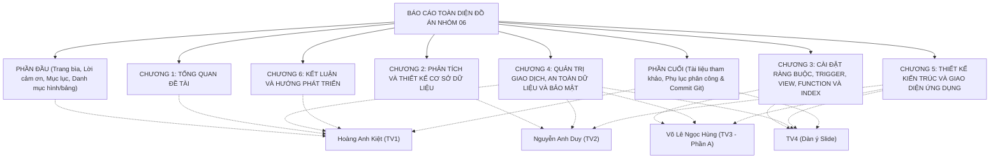

# QUY CHUẨN ĐỊNH DẠNG CHUNG BÁO CÁO ĐỒ ÁN
**MÔN HỌC: HỆ QUẢN TRỊ CƠ SỞ DỮ LIỆU (DBMS330284)**  
**ĐỀ TÀI: PHẦN MỀM QUẢN LÝ QUÁN CÀ PHÊ**  
**NHÓM 06 - HỌC KỲ 1, NĂM HỌC 2026 - 2027**

---

## 1. Mục đích và phạm vi áp dụng
Tài liệu này quy định toàn bộ tiêu chuẩn trình bày văn bản, căn lề, kiểu chữ, đánh số đề mục, đánh số hình ảnh/bảng biểu, quy cách trích dẫn mã nguồn và phân công trách nhiệm hợp nhất (merge) nội dung báo cáo giữa 4 thành viên Nhóm 06.

Mọi thành viên khi soạn thảo các phân đoạn báo cáo được phân công bắt buộc phải tuân thủ nghiêm ngặt các quy chuẩn dưới đây trước khi chuyển giao file cho Trưởng nhóm (Hoàng Anh Kiệt - TV1) tiến hành tổng hợp thành tệp báo cáo hoàn chỉnh (`BaoCao_Nhom06_DBMS.docx`).

---

## 2. Tiêu chuẩn định dạng văn bản (Word / Page Setup)

### 2.1. Thiết lập trang in (Page Setup)
- **Khổ giấy:** A4 ($210\text{ mm} \times 297\text{ mm}$).
- **Hướng giấy:** Portrait (thẳng đứng). Đối với các bảng biểu lớn (như Sơ đồ ERD hoặc Bảng đặc tả 16 bảng CSDL), có thể ngắt Section (`Section Break - Next Page`) để xoay ngang khổ giấy (Landscape) nếu cần thiết.
- **Căn lề (Margins):**
  - Lề trên (Top): $2.5\text{ cm}$ ($0.98''$).
  - Lề dưới (Bottom): $2.5\text{ cm}$ ($0.98''$).
  - Lề trái (Left - gáy sách để đóng cuốn): $3.5\text{ cm}$ ($1.38''$).
  - Lề phải (Right): $2.0\text{ cm}$ ($0.79''$).
  - Khoảng cách Header / Footer: $1.5\text{ cm}$.

### 2.2. Kiểu chữ và giãn dòng (Typography & Paragraph)
- **Font chữ chính:** `Times New Roman`.
- **Cỡ chữ nội dung (Body text):** `13 pt`.
- **Màu chữ:** Automatic / Black (`#000000`).
- **Căn lề đoạn văn:** Căn đều 2 bên (Justified).
- **Thụt đầu dòng đoạn văn:** First line indent $1.0\text{ cm}$ ($0.39''$) hoặc $1.27\text{ cm}$ ($0.5''$). Thống nhất chọn $1.0\text{ cm}$.
- **Giãn dòng (Line spacing):** $1.5\text{ lines}$.
- **Giãn đoạn (Paragraph Spacing):**
  - Before: `0 pt`.
  - After: `6 pt`.

### 2.3. Quy chuẩn tiêu đề các cấp (Headings)
Áp dụng tính năng tự động tạo mục lục (Multilevel List) của Microsoft Word:

| Cấp đề mục | Định dạng Word | Font chữ & Cỡ | Kiểu hiển thị | Quy tắc ngắt trang / Giãn cách |
| :--- | :--- | :--- | :--- | :--- |
| **Tên Chương** | Heading 1 | Times New Roman, 16 pt | **IN HOA, ĐẬM**, Căn giữa | Bắt buộc ngắt trang mới (`Ctrl + Enter`), Before 12pt, After 12pt |
| **Mục cấp 1 (1.1, 2.1...)** | Heading 2 | Times New Roman, 14 pt | **In hoa chữ cái đầu, Đậm**, Căn trái | Before 12pt, After 6pt, không thụt đầu dòng |
| **Mục cấp 2 (1.1.1, 2.1.1...)** | Heading 3 | Times New Roman, 13 pt | **In hoa chữ cái đầu, Đậm, Nghiêng**, Căn trái | Before 6pt, After 6pt, không thụt đầu dòng |
| **Mục cấp 3 (a, b hoặc 1.1.1.1)** | Heading 4 | Times New Roman, 13 pt | *Chữ thường, Nghiêng*, Căn trái | Before 6pt, After 6pt, thụt đầu dòng 1.0 cm |

> **Quy tắc tuyệt đối:** Không chia nhỏ đề mục vượt quá cấp 4 (nghĩa là không dùng đến mục 1.1.1.1.1).

---

## 3. Định dạng Bảng biểu, Hình ảnh và Đoạn mã nguồn

### 3.1. Quy chuẩn định dạng Bảng biểu (Tables)
- **Vị trí tên bảng:** Nằm **PHÍA TRÊN** bảng dữ liệu, căn giữa hoặc căn lề trái.
- **Quy tắc đánh số tên bảng:** Đánh số thứ tự kép theo chương:  
  `Bảng <Số Chương>.<Thứ tự bảng trong chương>: <Tên diễn giải ngắn gọn>`  
  *(Ví dụ: Bảng 2.1: Đặc tả cấu trúc bảng LoaiKhach, Bảng 3.2: Danh sách các Trigger trong hệ thống).*
- **Định dạng bảng:**
  - Header bảng: Nền xám nhạt (`#E0E0E0` hoặc `#F2F2F2`), chữ ĐẬM, căn giữa.
  - Nội dung trong bảng: Font Times New Roman, cỡ chữ `11 pt` hoặc `12 pt`, giãn dòng đơn (`Single`), Before 2pt, After 2pt.
  - Bảng phải có đường viền kẻ rõ ràng (Border mảnh 0.5pt, viền ngoài có thể 1pt).
  - Bật tính năng lặp lại dòng tiêu đề: `Table Properties -> Row -> Repeat as header row at the top of each page` khi bảng dài qua nhiều trang.
  - Phía dưới bảng ghi rõ nguồn (nếu có): `Nguồn: Nhóm 06 thiết kế dựa trên 01_schema_full.sql`.

### 3.2. Quy chuẩn định dạng Hình ảnh (Figures & Screenshots)
- **Vị trí hình ảnh:** Đặt ở giữa trang (Center), có đường viền mỏng bao quanh nếu là ảnh chụp màn hình nền trắng (`Border: 0.5 pt, màu xám nhạt #CCCCCC`).
- **Vị trí chú thích hình:** Nằm **PHÍA DƯỚI** hình ảnh, căn giữa, in nghiêng.
- **Quy tắc đánh số tên hình:** Đánh số thứ tự kép theo chương:  
  `Hình <Số Chương>.<Thứ tự hình trong chương>: <Tên diễn giải ngắn gọn>`  
  *(Ví dụ: Hình 2.1: Lược đồ quan hệ 16 bảng của quán cà phê, Hình 4.3: Minh chứng lỗi 229 khi bị DENY quyền trên SSMS).*
- **Đánh dấu giữ chỗ hình ảnh:** Trong bản thảo Markdown, mỗi vị trí cần chụp ảnh được ghi rõ theo cấu trúc:  
  `[CHÈN HÌNH: Mô tả chi tiết hành động cần thực hiện trên SSMS hoặc trên Form WinForms để chụp màn hình]`.

### 3.3. Quy chuẩn định dạng Mã nguồn (Code Snippets)
- **Font chữ:** `Consolas` hoặc `Courier New`.
- **Cỡ chữ:** `10 pt` (tối đa `10.5 pt`).
- **Giãn dòng:** Đơn (`Single line spacing`), Before `0 pt`, After `0 pt`.
- **Khung chứa code:** Đặt trong khung viền đơn (Border 0.5pt), màu nền xám nhạt (`#F8F9FA` hoặc `#F5F5F5`).
- **Quy tắc trích xuất code:**
  - Chỉ trích xuất các đoạn mã thực chất, loại bỏ các dòng lệnh rườm rà.
  - Giữ nguyên vẹn 100% tên bảng, tên cột, tên biến, tên thủ tục từ source code `database/01_schema_full.sql` và source code C#.
  - Có các dòng chú thích ngắn gọn bằng tiếng Việt để giảng viên chấm thi theo dõi logic nhanh chóng.

---

## 4. Bố cục tổng thể của Báo cáo Đồ án Nhóm 06

Báo cáo hoàn chỉnh có cấu trúc gồm 6 chương cùng các phần bổ trợ, được phân bổ trách nhiệm cụ thể như sau:

---

## 5. Bảng phân công chi tiết và phân chia file bản thảo

Để đảm bảo tiến độ và tránh xung đột khi gộp văn bản, đồ án được chia thành 4 file tài liệu thành viên:

| File tài liệu | Thành viên phụ trách | Vai trò & Phân hệ | Khối lượng dự kiến | Các nội dung trọng tâm phụ trách |
| :--- | :--- | :--- | :---: | :--- |
| `TV1_HoangAnhKiet_TruongNhom.md` | **Hoàng Anh Kiệt** (Trưởng nhóm) | Nền tảng, Quản trị, Bảo mật | 14 – 16 trang | • Trang bìa, Mục lục, Danh mục Bảng/Hình. • Chương 1: Lý do chọn đề tài, khảo sát bài toán quán cà phê, phạm vi. • Chương 4 (Phần Bảo mật RBAC, cơ chế Ownership Chaining, GRANT/REVOKE/DENY). • Chương 4 (Phần Recovery WAL, ARIES, Kịch bản Full/Diff/Log Backup & Restore). • Chương 6: Kết luận, hạn chế, hướng mở rộng. • Tài liệu tham khảo và Phụ lục đóng góp thành viên qua Git. |
| `TV2_NguyenAnhDuy_BanHang_Transaction.md` | **Nguyễn Anh Duy** | Bán hàng (POS), Giao dịch | 18 – 20 trang | • Chương 2: Mô hình ERD, Lược đồ quan hệ 16 bảng, Phân tích chuẩn hóa 3NF. • Chương 2: Bảng đặc tả chi tiết 16 bảng trong CSDL (khớp 100% SQL). • Chương 4 (Phần Giao dịch Bán hàng: 5 SP `sp_TaoHoaDon`, `sp_ThemMonVaoHoaDon`, `sp_ThanhToanHoaDon`, `sp_HuyHoaDon`, `sp_CapNhatSoLuongMon`). • Chương 4 (Phần Xử lý Concurrency: Lost Update/Dirty Read, mức cô lập `REPEATABLE READ`, khóa `UPDLOCK, HOLDLOCK`). • Chương 5: Giao diện POS, Bán tại quán/Mang về, Thanh toán VietQR, Quản lý Bàn. |
| `TV3_VoLeNgocHung_Kho_Trigger_Index.md` | **Võ Lê Ngọc Hùng** | Kho, Trigger, Chỉ mục | 14 – 16 trang | • Chương 3 – Phần A: Bảng phân tích toàn bộ Ràng buộc CHECK, UNIQUE, DEFAULT. • Chương 3 – Phần A: Trích xuất và giải thích hoạt động của cả 6 Trigger. • Chương 3 – Phần A: Phân tích 5 Nonclustered Index, cấu trúc B-Tree, kịch bản đo lường với `SET STATISTICS IO/TIME ON`. • Chương 4: Giao dịch Nhập kho (`sp_NhapKho`, `sp_ThemChiTietPhieuNhap`, `sp_NhapKhoTronGoi` với OPENJSON). • Chương 5: Giao diện Quản lý Kho, Nhập kho, Nhà cung cấp, Thức uống, Công thức pha chế. |
| `TV4_NguyenThaiSon_View_Function_KienTruc_BaoCao.md` | **Nguyễn Thái Sơn** | Báo cáo, Kế toán, Kiến trúc 3 tầng | 16 – 18 trang | • Chương 3 – Phần B: Trích xuất và giải thích 6 View báo cáo/tổng hợp. • Chương 3 – Phần B: Trích xuất và giải thích 6 User-Defined Function (Scalar & Table-Valued). • Chương 3 – Phần B: Nhóm các Stored Procedure quản lý (Khách hàng, Nhân viên, Danh mục). • Chương 4: Giao dịch Chi tiền (`sp_ChiTienNCC`). • Chương 5: Kiến trúc 3 tầng C# WinForms, cơ chế hoạt động của `DbHelper.cs`, `CustomSqlExceptionHandler.cs`, `Theme.cs`, chuyển đổi chuỗi kết nối theo Role đăng nhập. • Chương 5: Giao diện Đăng nhập, Khách hàng, Báo cáo Doanh thu, Phiếu chi, Nhân viên. • Dàn ý chi tiết 15 Slide thuyết trình PowerPoint. |

---

## 6. Quy trình phối hợp và kiểm soát chất lượng (Checklist)

1. **Kiểm tra tính nhất quán mã nguồn:** Mọi thành viên tuyệt đối không tự ý đổi tên bảng (phải đúng: `Ban`, `ChiTietHoaDon`, `ChiTietPhieuNhap`, `CongThuc`, `HoaDon`, `Khach`, `LoaiKhach`, `LoaiNguyenLieu`, `LoaiThucUong`, `NguyenLieu`, `NhaCungCap`, `NhanVien`, `PhieuChi`, `PhieuNhap`, `ThucUong`, `ViTriBan`).
2. **Kiểm tra tính tương thích tham số:** Tên tham số SP và tên cột phải đúng chính xác chữ hoa/chữ thường như trong `01_schema_full.sql`.
3. **Chụp ảnh minh chứng sắc nét:** Ảnh chụp trên SQL Server Management Studio (SSMS) và ứng dụng C# WinForms phải rõ chữ, không bị mờ nhòe, không chụp xéo bằng điện thoại.
4. **Hạn chót hoàn thành bản nháp:** Các thành viên hoàn thành file Markdown tương ứng trong thư mục `docs/bao_cao/`. Trưởng nhóm Hoàng Anh Kiệt sẽ tiến hành rà soát, đồng bộ số thứ tự Hình/Bảng và xuất bản bản in hoàn chỉnh nộp giảng viên hướng dẫn.

