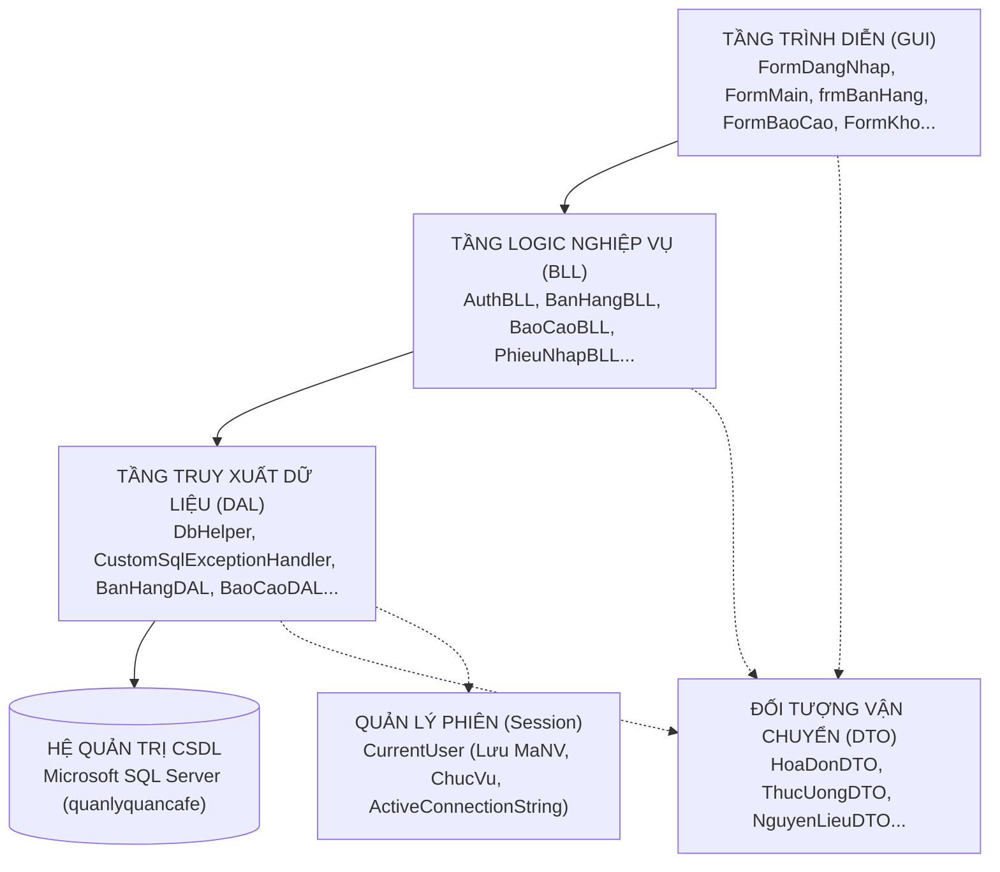

# BẢN THẢO BÁO CÁO ĐỒ ÁN - THÀNH VIÊN 4
**HỌ VÀ TÊN:** NGUYỄN THÁI SƠN (TV4)  
**VAI TRÒ TRONG DỰ ÁN:** View, Function, Báo cáo, Kế toán & Kiến trúc phần mềm  
**PHẠM VI ĐÓNG GÓP:** Chương 3 – Phần B (6 View, 6 Function, Stored Procedure quản lý), Chương 4 (Giao dịch Chi tiền), Chương 5 (Kiến trúc 3 tầng, DbHelper, CustomSqlExceptionHandler, AppConfig, Giao diện Quản lý, Báo cáo, Chi tiền, Khách hàng), Dàn ý 15 Slide thuyết trình  

---

# CHƯƠNG 3: CÀI ĐẶT RÀNG BUỘC, TRIGGER, CHỈ MỤC, VIEW VÀ FUNCTION (PHẦN B: VIEW, FUNCTION VÀ STORED PROCEDURE QUẢN LÝ)

## 3.4. Hệ thống Khung nhìn (Views)

### 3.4.1. Vai trò của Khung nhìn (View) trong cơ sở dữ liệu
Khung nhìn (View) là một bảng ảo (Virtual Table) được định nghĩa bởi một câu truy vấn SQL bên dưới. Trong hệ thống `quanlyquancafe`, các View đóng vai trò đặc biệt quan trọng:
1. **Đơn giản hóa truy vấn phức tạp:** Gom nhóm các câu lệnh kết nối nhiều bảng (`JOIN`), tính toán tổng hợp (`SUM`, `COUNT`, `GROUP BY`) thành một đối tượng duy nhất để ứng dụng phía Client dễ dàng truy vấn như một bảng đơn thuần.
2. **Tăng cường bảo mật và kiểm soát truy cập:** Cung cấp cho các vai trò người dùng (như Kế toán hoặc Thu ngân) các khung nhìn chỉ chứa các cột được phép xem, ngăn chặn việc truy cập trực tiếp vào các bảng nhạy cảm.
3. **Đảm bảo tính nhất quán của số liệu:** Toàn bộ công thức tính toán tài chính (như trừ tiền giảm giá, tính thành tiền) được đóng gói tập trung tại CSDL, đảm bảo mọi màn hình báo cáo đều xuất ra cùng một kết quả đồng nhất.

---

### 3.4.2. Trích xuất mã nguồn và phân tích chi tiết 6 Khung nhìn

#### 1. Khung nhìn `v_PhieuNhap`: Tổng hợp tiền hàng phiếu nhập kho
- **Mục đích:** Tính toán tổng tiền thực tế của từng phiếu nhập kho bằng cách cộng dồn cột `ThanhTien` từ bảng `ChiTietPhieuNhap`.
- **Kỹ thuật:** Sử dụng `LEFT JOIN` kết hợp hàm `COALESCE(SUM(ct.ThanhTien), 0)` để xử lý an toàn các phiếu nhập vừa tạo chưa có dòng chi tiết nào (trả về 0 thay vì NULL).
- **Mã nguồn SQL:**
```sql
CREATE OR ALTER VIEW v_PhieuNhap AS
SELECT 
    pn.MaPN,
    pn.NgayNhap,
    pn.GhiChu,
    pn.MaNCC,
    pn.MaNV,
    COALESCE(SUM(ct.ThanhTien), 0) AS TongTien
FROM PhieuNhap pn
LEFT JOIN ChiTietPhieuNhap ct ON pn.MaPN = ct.MaPN
GROUP BY pn.MaPN, pn.NgayNhap, pn.GhiChu, pn.MaNCC, pn.MaNV;
GO
```

---

#### 2. Khung nhìn `v_HoaDon`: Bảng kê hóa đơn và tính toán số tiền thanh toán
- **Mục đích:** Cung cấp thông tin toàn diện về hóa đơn cho màn hình báo cáo và thu ngân: Tiền hàng trước giảm giá (`TongTienHang`), Tiền giảm giá (`TienGiamGia`), Tiền thanh toán thực tế (`TongTienThanhToan`) và Điểm tích lũy.
- **Kỹ thuật:** Sử dụng biểu thức `CASE WHEN` ngăn chặn trường hợp số tiền thanh toán bị âm do chiết khấu vượt quá tiền hàng:
  $$\text{TongTienThanhToan} = \max(0, \text{TongTienHang} - \text{TienGiamGia})$$
- **Mã nguồn SQL:**
```sql
CREATE OR ALTER VIEW v_HoaDon AS
SELECT 
    hd.MaHD,
    hd.NgayLap,
    hd.NgayThanhToan,
    hd.MaKH,
    hd.MaNV,
    hd.MaBan,
    hd.TrangThai,
    hd.PhuongThucThanhToan,
    COALESCE(SUM(ct.ThanhTien), 0) AS TongTienHang,
    hd.TienGiamGia,
    CASE 
        WHEN COALESCE(SUM(ct.ThanhTien), 0) - hd.TienGiamGia < 0 THEN 0
        ELSE COALESCE(SUM(ct.ThanhTien), 0) - hd.TienGiamGia 
    END AS TongTienThanhToan,
    hd.DiemTichLuyCong
FROM HoaDon hd
LEFT JOIN ChiTietHoaDon ct ON hd.MaHD = ct.MaHD
GROUP BY 
    hd.MaHD, hd.NgayLap, hd.NgayThanhToan, hd.MaKH, 
    hd.MaNV, hd.MaBan, hd.TrangThai, hd.PhuongThucThanhToan, 
    hd.TienGiamGia, hd.DiemTichLuyCong;
GO
```

---

#### 3. Khung nhìn `v_MonBanChay`: Thống kê sản lượng và doanh thu từng món
- **Mục đích:** Giúp chủ quán nhận diện các món đồ uống bán chạy nhất (Best-Seller) để lên kế hoạch nhập hàng nguyên liệu tương ứng.
- **Kỹ thuật:** Lọc nghiêm ngặt điều kiện `WHERE hd.TrangThai = N'Đã thanh toán'`, loại bỏ các đơn bị hủy hoặc chưa thanh toán. Sử dụng `RIGHT JOIN ThucUong` để hiển thị đầy đủ mọi món trong thực đơn kể cả các món chưa bán được ly nào (sản lượng = 0).
- **Mã nguồn SQL:**
```sql
CREATE OR ALTER VIEW v_MonBanChay AS
SELECT
    tu.MaThucUong,
    tu.TenThucUong,
    COALESCE(SUM(ct.SoLuong), 0) AS TongSoLuongBan,
    COALESCE(SUM(ct.ThanhTien), 0) AS TongDoanhThu
FROM ChiTietHoaDon ct
JOIN HoaDon hd ON ct.MaHD = hd.MaHD AND hd.TrangThai = N'Đã thanh toán'
RIGHT JOIN ThucUong tu ON ct.MaThucUong = tu.MaThucUong
GROUP BY tu.MaThucUong, tu.TenThucUong;
GO
```

---

#### 4. Khung nhìn `v_TonKhoCanhBao`: Cảnh báo nguyên liệu chạm ngưỡng an toàn
- **Mục đích:** Cung cấp danh sách các nguyên liệu có số lượng tồn kho thấp hơn hoặc bằng mức tối thiểu (`SoLuongTonKho <= MucToiThieu`).
- **Ứng dụng:** Được gọi trực tiếp trên màn hình Quản lý kho của Thủ kho để hiển thị danh sách các nguyên liệu cần đặt hàng gấp từ nhà cung cấp.
- **Mã nguồn SQL:**
```sql
CREATE OR ALTER VIEW v_TonKhoCanhBao AS
SELECT
    nl.MaNL,
    nl.TenNL,
    nl.SoLuongTonKho,
    nl.MucToiThieu,
    lnl.TenLoai AS LoaiNguyenLieu
FROM NguyenLieu nl
JOIN LoaiNguyenLieu lnl ON lnl.MaLoaiNL = nl.MaLoaiNL
WHERE nl.SoLuongTonKho <= nl.MucToiThieu;
GO
```

---

#### 5. Khung nhìn `v_DoanhThuTheoNgay`: Thống kê doanh thu bán hàng theo từng ngày
- **Mục đích:** Hỗ trợ kế toán và chủ quán theo dõi doanh số kinh doanh hàng ngày, số lượng hóa đơn phát sinh trong ngày.
- **Kỹ thuật:** Ép kiểu thời gian `CAST(hd.NgayLap AS DATE)` để gom nhóm chính xác toàn bộ các đơn hàng phát sinh trong cùng một ngày bất kể khung giờ bán.
- **Mã nguồn SQL:**
```sql
CREATE OR ALTER VIEW v_DoanhThuTheoNgay AS
SELECT
    CAST(hd.NgayLap AS DATE) AS Ngay,
    COUNT(DISTINCT hd.MaHD) AS SoHoaDon,
    SUM(ct.ThanhTien) AS TongDoanhThu
FROM HoaDon hd
JOIN ChiTietHoaDon ct ON hd.MaHD = ct.MaHD
WHERE hd.TrangThai = N'Đã thanh toán'
GROUP BY CAST(hd.NgayLap AS DATE);
GO
```

---

#### 6. Khung nhìn `v_KhachHangThanThiet`: Danh sách khách hàng và quyền lợi thành viên
- **Mục đích:** Kết nối bảng `Khach` với `LoaiKhach` để hiển thị tên khách hàng, điểm tích lũy, tên hạng thẻ (Thường, Thân thiết, VIP) và tỷ lệ chiết khấu được hưởng.
- **Mã nguồn SQL:**
```sql
CREATE OR ALTER VIEW v_KhachHangThanThiet AS
SELECT
    kh.MaKH,
    kh.TenKH,
    kh.DiemTichLuy,
    lkh.TenLoai AS LoaiKhachHang,
    lkh.ChietKhau
FROM Khach kh
JOIN LoaiKhach lkh ON lkh.MaLoaiKH = kh.MaLoaiKH;
GO
```

[CHÈN HÌNH: Ảnh chụp màn hình kết quả truy vấn dữ liệu từ 6 View trong SSMS: `v_HoaDon`, `v_MonBanChay`, `v_TonKhoCanhBao`]

---

## 3.5. Hàm người dùng định nghĩa (User-Defined Functions)

Nhóm 06 xây dựng 6 User-Defined Function (UDF) gồm 4 hàm vô hướng (Scalar Function) và 2 hàm bảng nội tuyến (Inline Table-Valued Function):

### 3.5.1. Phân tích 4 Hàm vô hướng (Scalar Functions)

#### 1. Hàm `fn_TinhThanhTienHoaDon`: Tính tổng tiền món ăn của hóa đơn
- **Tham số đầu vào:** `@MaHD VARCHAR(20)`.
- **Giá trị trả về:** `DECIMAL(12,2)` - Tổng số tiền của toàn bộ các dòng chi tiết trong hóa đơn.
- **Mã nguồn SQL:**
```sql
CREATE OR ALTER FUNCTION fn_TinhThanhTienHoaDon (@MaHD VARCHAR(20))
RETURNS DECIMAL(12,2)
AS
BEGIN
    DECLARE @TongTien DECIMAL(12,2);
    SELECT @TongTien = SUM(ThanhTien) FROM ChiTietHoaDon WHERE MaHD = @MaHD;
    RETURN ISNULL(@TongTien, 0);
END
GO
```

---

#### 2. Hàm `fn_KiemTraDuNguyenLieu`: Kiểm tra khả năng pha chế
- **Tham số đầu vào:** `@MaThucUong VARCHAR(20)`, `@SoLuong INT`.
- **Giá trị trả về:** `BIT` (Trả về `1` nếu trong kho đủ toàn bộ nguyên liệu pha chế `@SoLuong` ly; trả về `0` nếu có ít nhất 1 nguyên liệu bị thiếu).
- **Mã nguồn SQL:**
```sql
CREATE OR ALTER FUNCTION fn_KiemTraDuNguyenLieu (@MaThucUong VARCHAR(20), @SoLuong INT)
RETURNS BIT
AS
BEGIN
    DECLARE @KetQua BIT = 1;

    IF EXISTS (
        SELECT 1
        FROM CongThuc ct
        JOIN NguyenLieu nl ON nl.MaNL = ct.MaNL
        WHERE ct.MaThucUong = @MaThucUong
          AND nl.SoLuongTonKho < ct.SoLuongQuyDinh * @SoLuong
    )
        SET @KetQua = 0;

    RETURN @KetQua;
END
GO
```

---

#### 3. Hàm `fn_ChietKhauTheoLoaiKH`: Lấy phần trăm giảm giá theo khách hàng
- **Tham số đầu vào:** `@MaKH VARCHAR(20)`.
- **Giá trị trả về:** `DECIMAL(5,2)` - Tỷ lệ phần trăm chiết khấu của loại khách hàng tương ứng.
- **Mã nguồn SQL:**
```sql
CREATE OR ALTER FUNCTION fn_ChietKhauTheoLoaiKH (@MaKH VARCHAR(20))
RETURNS DECIMAL(5,2)
AS
BEGIN
    DECLARE @ChietKhau DECIMAL(5,2);
    SELECT @ChietKhau = lkh.ChietKhau
    FROM Khach kh
    JOIN LoaiKhach lkh ON lkh.MaLoaiKH = kh.MaLoaiKH
    WHERE kh.MaKH = @MaKH;
    RETURN ISNULL(@ChietKhau, 0);
END
GO
```

---

#### 4. Hàm `fn_SinhMaTuDong`: Tự động sinh mã kế tiếp theo quy tắc
- **Tham số đầu vào:** `@TienTo VARCHAR(5)` (`'HD'`, `'PN'`, hoặc `'KH'`).
- **Giá trị trả về:** `VARCHAR(20)` - Chuỗi mã định dạng chuẩn 8 ký tự (Ví dụ: `HD000015`, `PN000004`).
- **Mã nguồn SQL:**
```sql
CREATE OR ALTER FUNCTION fn_SinhMaTuDong (@TienTo VARCHAR(5))
RETURNS VARCHAR(20)
AS
BEGIN
    DECLARE @MaMoi VARCHAR(20);
    DECLARE @MaxID INT = 0;

    IF @TienTo = 'HD'
        SELECT @MaxID = ISNULL(MAX(CAST(SUBSTRING(MaHD, 3, 10) AS INT)), 0) FROM HoaDon;
    ELSE IF @TienTo = 'PN'
        SELECT @MaxID = ISNULL(MAX(CAST(SUBSTRING(MaPN, 3, 10) AS INT)), 0) FROM PhieuNhap;
    ELSE IF @TienTo = 'KH'
        SELECT @MaxID = ISNULL(MAX(CAST(SUBSTRING(MaKH, 3, 10) AS INT)), 0) FROM Khach;

    SET @MaMoi = @TienTo + RIGHT('000000' + CAST(@MaxID + 1 AS VARCHAR(10)), 6);
    RETURN @MaMoi;
END
GO
```

---

### 3.5.2. Phân tích 2 Hàm bảng nội tuyến (Table-Valued Functions)

#### 5. Hàm `fn_MonBanChayNhat`: Lấy danh sách Top món bán chạy trong khoảng ngày
- **Tham số đầu vào:** `@TuNgay DATE`, `@DenNgay DATE`.
- **Giá trị trả về:** Bảng chứa danh sách Top 10 món có số lượng bán nhiều nhất trong khoảng thời gian được chỉ định.
- **Mã nguồn SQL:**
```sql
CREATE OR ALTER FUNCTION fn_MonBanChayNhat (@TuNgay DATE, @DenNgay DATE)
RETURNS TABLE
AS
RETURN
(
    SELECT TOP 10
        tu.MaThucUong,
        tu.TenThucUong,
        SUM(ct.SoLuong) AS TongSoLuongBan
    FROM ChiTietHoaDon ct
    JOIN HoaDon hd ON hd.MaHD = ct.MaHD
    JOIN ThucUong tu ON tu.MaThucUong = ct.MaThucUong
    WHERE hd.TrangThai = N'Đã thanh toán'
      AND CAST(hd.NgayLap AS DATE) BETWEEN @TuNgay AND @DenNgay
    GROUP BY tu.MaThucUong, tu.TenThucUong
);
GO
```

---

#### 6. Hàm `fn_LichSuMuaHang`: Tra cứu lịch sử mua hàng của khách hàng
- **Tham số đầu vào:** `@MaKH VARCHAR(20)`.
- **Giá trị trả về:** Bảng gồm danh sách toàn bộ các hóa đơn đã mua của khách hàng, ngày mua, trạng thái và tổng tiền của từng hóa đơn.
- **Mã nguồn SQL:**
```sql
CREATE OR ALTER FUNCTION fn_LichSuMuaHang (@MaKH VARCHAR(20))
RETURNS TABLE
AS
RETURN
(
    SELECT
        hd.MaHD,
        hd.NgayLap,
        hd.TrangThai,
        dbo.fn_TinhThanhTienHoaDon(hd.MaHD) AS TongTien
    FROM HoaDon hd
    WHERE hd.MaKH = @MaKH
);
GO
```

[CHÈN HÌNH: Ảnh chụp màn hình kiểm thử thực thi các Hàm trong SSMS: Gọi `SELECT dbo.fn_TinhThanhTienHoaDon('HD000001')` và `SELECT * FROM dbo.fn_MonBanChayNhat('2026-09-01', '2026-10-14')`]

---

## 3.6. Hệ thống Stored Procedure quản lý nghiệp vụ và bẫy lỗi TRY...CATCH

Bên cạnh các thủ tục bán hàng và nhập kho, nhóm xây dựng hệ thống các Stored Procedure quản trị nghiệp vụ với cấu trúc bẫy lỗi chuẩn hóa:

*Bảng 3.3: Phân nhóm các Stored Procedure quản lý tiêu biểu*

| Nhóm nghiệp vụ | Tên Stored Procedure | Tham số chính | Vai trò nghiệp vụ |
| :--- | :--- | :--- | :--- |
| **Xác thực & Bảo mật** | `sp_DangNhap` | `@SoDienThoai, @MatKhau` | Xác thực đăng nhập bằng cách băm mật khẩu `HASHBYTES('SHA2_256', @MatKhau)` và so khớp trong bảng `NhanVien`. |
| | `sp_DoiMatKhau` | `@MaNV, @MatKhauCu, @MatKhauMoi` | Cho phép nhân viên tự đổi mật khẩu cá nhân khi cung cấp đúng mật khẩu cũ. |
| | `sp_DatLaiMatKhau` | `@MaNV, @MatKhauMoi` | Dành riêng cho Quản lý cấp lại mật khẩu cho nhân viên bị quên. |
| **Quản lý Khách hàng**| `sp_ThemKhachHang` | `@TenKH, @SoDienThoai, @MaLoaiKH` | Tự động sinh mã qua sequence `Seq_Khach`, kiểm tra trùng số điện thoại. |
| | `sp_SuaKhach` | `@MaKH, @TenKH, @SoDienThoai, @MaLoaiKH` | Cập nhật thông tin khách hàng. |
| | `sp_XoaKhach` | `@MaKH` | Xóa khách hàng (chỉ cho phép xóa khi khách chưa phát sinh hóa đơn). |
| | `sp_TimKiemKhach` | `@TuKhoa` | Tìm kiếm khách hàng theo tên hoặc số điện thoại. |
| **Quản lý Nhân sự** | `sp_ThemNhanVien` | `@MaNV, @TenNV, @ChucVu, @SDT, @MatKhau, @MaQL` | Thêm nhân viên mới, tự động băm mật khẩu ban đầu thành mã SHA2_256. |
| | `sp_SuaNhanVien` | `@MaNV, @TenNV, @ChucVu, @SDT, @CaLamViec, @MaQL` | Cập nhật thông tin hành chính của nhân viên (không sửa mật khẩu qua SP này). |
| | `sp_LayDanhSachNhanVien`| *(Không có)* | Lấy danh sách nhân viên phục vụ form quản lý. |
| **Báo cáo & Thống kê** | `sp_ThongKeDoanhThu` | `@TuNgay, @DenNgay` | Thống kê số lượng hóa đơn và tổng doanh thu theo từng ngày trong khoảng thời gian. |
| | `sp_LayDanhSachPhieuChi`| `@TuNgay, @DenNgay` | Liệt kê lịch sử các khoản chi tiền kèm tên nhà cung cấp và nhân viên chi. |
| **Danh mục nạp ComboBox**| `sp_LayDanhSachLoaiKhach`, `sp_LayDanhSachLoaiThucUong`, `sp_LayDanhSachLoaiNguyenLieu`, `sp_LayDanhSachViTriBan`, `sp_LayDanhSachNCC` | *(Không có)* | Trả về danh sách định danh và tên gọi để nạp dữ liệu nhanh vào các điều khiển `ComboBox` trên giao diện người dùng. |

---

# CHƯƠNG 4: QUẢN TRỊ GIAO DỊCH TRONG PHÂN HỆ CHI TIỀN (BỔ SUNG)

## 4.4. Quản lý giao dịch trong nghiệp vụ Chi tiền (`sp_ChiTienNCC`)
Nghiệp vụ chi tiền của quán do kế toán (`user_ketoan`) phụ trách, bao gồm việc thanh toán tiền hàng cho nhà cung cấp hoặc chi trả chi phí vận hành (mặt bằng, điện nước, sửa chữa máy móc):

```sql
CREATE OR ALTER PROCEDURE sp_ChiTienNCC
    @MaPC      VARCHAR(20) = NULL OUTPUT,
    @SoTienChi DECIMAL(12, 2),
    @LyDoChi   NVARCHAR(255),
    @MaNV      VARCHAR(20),
    @MaNCC     VARCHAR(20) = NULL
AS
BEGIN
    SET NOCOUNT ON;
    SET XACT_ABORT ON;
    BEGIN TRY
        IF @SoTienChi IS NULL OR @SoTienChi <= 0
            THROW 50000, N'Số tiền chi phải lớn hơn 0.', 1;

        IF @MaNCC IS NOT NULL AND NOT EXISTS (SELECT 1 FROM NhaCungCap WHERE MaNCC = @MaNCC)
            THROW 50000, N'Nhà cung cấp không tồn tại.', 1;

        IF NOT EXISTS (SELECT 1 FROM NhanVien WHERE MaNV = @MaNV)
            THROW 50000, N'Nhân viên không tồn tại.', 1;

        BEGIN TRANSACTION;
            -- Tự động sinh mã phiếu chi tăng dần
            DECLARE @SeqVal BIGINT = NEXT VALUE FOR Seq_PhieuChi;
            SET @MaPC = 'PC' + RIGHT('000000' + CAST(@SeqVal AS VARCHAR(10)), 6);

            INSERT INTO PhieuChi (MaPC, NgayChi, SoTienChi, LyDoChi, MaNCC, MaNV)
            VALUES (@MaPC, GETDATE(), @SoTienChi, @LyDoChi, @MaNCC, @MaNV);
        COMMIT TRANSACTION;

        SELECT N'Tạo phiếu chi thành công' AS KetQua, @MaPC AS MaPC;
    END TRY
    BEGIN CATCH
        IF XACT_STATE() <> 0 ROLLBACK TRANSACTION;
        THROW;
    END CATCH
END
GO
```

**Cơ chế bảo vệ giao dịch:**
- Sử dụng `SET XACT_ABORT ON` để đảm bảo nếu gặp sự cố nghiêm trọng, toàn bộ giao dịch lập tức bị hủy bỏ.
- Kiểm tra số tiền chi bắt buộc phải $> 0$. Nếu kế toán nhập số tiền âm hoặc bằng 0, thủ tục phát lệnh `THROW 50000` chặn đứng thao tác.
- Mã phiếu chi được cấp phát tuần tự và an toàn từ sequence `Seq_PhieuChi`.

---

# CHƯƠNG 5: THIẾT KẾ KIẾN TRÚC VÀ GIAO DIỆN ỨNG DỤNG (PHẦN KIẾN TRÚC, QUẢN LÝ VÀ BÁO CÁO)

## 5.10. Kiến trúc 3 tầng và cơ chế bảo mật chuyển đổi chuỗi kết nối

### 5.10.1. Mô hình kiến trúc 3 tầng (3-Tier Architecture)
Ứng dụng WinForms được xây dựng theo kiến trúc 3 tầng tách biệt nhằm nâng cao tính mở rộng, bảo trì và tái sử dụng mã nguồn:



- **Tầng Trình diễn (GUI):** Chứa các Windows Form giao diện người dùng, chịu trách nhiệm nhận tương tác, hiển thị dữ liệu và xác thực định dạng đầu vào cơ bản.
- **Tầng Logic Nghiệp vụ (BLL):** Chứa các quy tắc nghiệp vụ, kiểm tra ràng buộc logic, gọi tầng DAL và chuyển đổi dữ liệu thành các danh sách DTO.
- **Tầng Truy xuất Dữ liệu (DAL):** Giao tiếp trực tiếp với Microsoft SQL Server qua thư viện `Microsoft.Data.SqlClient`. Toàn bộ các thao tác `SELECT`, `EXECUTE SP`, gọi hàm đều tập trung thông qua lớp tiện ích `DbHelper.cs`.
- **Lớp DTO (Data Transfer Object):** Các class POCO đóng gói dữ liệu truyền tải giữa các tầng mà không làm lộ cấu trúc vật lý của CSDL.

---

### 5.10.2. Lớp tiện ích `DbHelper.cs` và cơ chế thực thi an toàn
Lớp tĩnh `DbHelper.cs` là xương sống của tầng DAL, tập trung hóa việc mở/đóng kết nối và giải phóng tài nguyên tự động với khối `using`:
- **`ExecSP(spName, params)`:** Thực thi Stored Procedure trả về bảng `DataTable`.
- **`ExecSPNonQuery(spName, params)`:** Thực thi Stored Procedure không trả về kết quả (thực hiện thêm/xóa/sửa).
- **`ExecScalarFn(fnName, params)`:** Thực thi hàm vô hướng bằng cú pháp `SELECT dbo.fnName(...)`.
- **`ExecTableFn(fnName, params)`:** Thực thi hàm trả về bảng bằng cú pháp `SELECT * FROM dbo.fnName(...)`.
- **`SelectView(viewName, where, params)`:** Truy vấn khung nhìn an toàn, truyền tham số qua `SqlParameter` để ngăn chặn triệt để lỗ hổng SQL Injection.

---

### 5.10.3. Cơ chế bắt lỗi tập trung `CustomSqlExceptionHandler.cs`
Khi phát sinh lỗi từ SQL Server, lớp `CustomSqlExceptionHandler` chặn bắt ngoại lệ `SqlException` và chuyển đổi các mã lỗi kỹ thuật phức tạp thành thông điệp tiếng Việt gần gũi:

*Bảng 5.1: Bảng ánh xạ mã lỗi SQL Server trong CustomSqlExceptionHandler*

| Mã lỗi SQL Server | Tình huống phát sinh thực tế | Thông báo chuyển đổi hiển thị cho người dùng |
| :---: | :--- | :--- |
| **50000** | Lỗi nghiệp vụ từ lệnh `THROW` hoặc `RAISERROR` trong SP/Trigger (như thiếu nguyên liệu, số tiền $\le 0$) | Hiển thị nguyên văn thông báo nghiệp vụ do SP định nghĩa |
| **2627 / 2601** | Vi phạm ràng buộc khóa chính (`PK`) hoặc khóa duy nhất (`UNIQUE`), như trùng số điện thoại, trùng số bàn | *"Dữ liệu hoặc mã này đã tồn tại trong hệ thống."* |
| **547** | Vi phạm ràng buộc khóa ngoại (`FK`) khi cố tình xóa danh mục đang có giao dịch liên kết | *"Dữ liệu vi phạm ràng buộc hoặc đang được sử dụng ở bảng khác (không thể xóa)."* |
| **229 / 230 / 262**| Người dùng cố tình truy cập vào bảng hoặc SP bị cấm bởi lệnh `DENY` | *"Bạn không có quyền thực hiện chức năng này."* |
| **-2, 53, 4060...**| Mất kết nối mạng hoặc máy chủ SQL Server bị dừng dịch vụ | *"Mất kết nối tới máy chủ CSDL SQL Server. Vui lòng kiểm tra và thử lại."* |

---

### 5.10.4. Cơ chế bảo mật chuyển đổi chuỗi kết nối theo vai trò trong `AppConfig.cs`
Khác với các ứng dụng thông thường sử dụng cố định một chuỗi kết nối duy nhất (thường dùng tài khoản `sa`), phần mềm của Nhóm 06 thực hiện cơ chế bảo mật động:
1. **Giai đoạn trước khi đăng nhập:** Ứng dụng chỉ sử dụng chuỗi kết nối `AuthConn` (tài khoản `login_auth`). Tài khoản này chỉ có quyền duy nhất là gọi `sp_DangNhap`. Kể cả khi kẻ tấn công decompile mã nguồn phần mềm, họ cũng không thể dùng `AuthConn` để xem dữ liệu bàn, hóa đơn hay nguyên liệu.
2. **Giai đoạn sau khi đăng nhập thành công:** Lớp `AppConfig.ConnectionForRole(chucVu)` tự động chọn chuỗi kết nối tương ứng với vai trò của nhân viên:
   - Quản lý $\rightarrow$ `QuanLyConn` (tài khoản `login_quantri`, quyền `db_owner`).
   - Phục vụ / Thu ngân $\rightarrow$ `PhucVuConn` (tài khoản `login_phucvu`, quyền `NhanVienPhucVu`).
   - Thủ kho $\rightarrow$ `ThuKhoConn` (tài khoản `login_thukho`, quyền `ThuKho`).
   - Kế toán $\rightarrow$ `KeToanConn` (tài khoản `login_ketoan`, quyền `KeToan`).
3. Chuỗi kết nối này được gán vào `CurrentUser.ActiveConnectionString` và được `DbHelper` sử dụng cho mọi thao tác tiếp theo. Điều này đảm bảo tính bảo mật được thực thi nghiêm ngặt tại tầng CSDL.

---

## 5.11. Các màn hình chức năng do TV4 phụ trách

### 1. Màn hình Đăng nhập (`FormDangNhap.cs` / `frmDangNhap.cs`) & Đổi mật khẩu (`FormDoiMatKhau.cs`)
- Nhập số điện thoại và mật khẩu. Gọi `AuthBLL.DangNhap(...)` thực thi `sp_DangNhap`.
- Kiểm tra tính hợp lệ và tự động phân quyền mở menu tương ứng trên `FormMain`.

[CHÈN HÌNH: Giao diện màn hình Đăng nhập hệ thống với giao diện phẳng hiện đại]

### 2. Màn hình Quản lý Khách hàng (`FormKhach.cs`)
- Quản lý thông tin hội viên, tra cứu điểm thưởng, đổi loại thẻ.
- Hiển thị lịch sử các đơn hàng đã mua của khách qua hàm bảng `fn_LichSuMuaHang`.

[CHÈN HÌNH: Giao diện màn hình Quản lý Khách hàng và lịch sử hóa đơn mua hàng của khách]

### 3. Màn hình Báo cáo Thống kê (`FormBaoCao.cs`)
- Thiết kế gồm 3 tab chuyên sâu:
  - **Tab 1 - Doanh thu theo ngày:** Lọc theo khoảng ngày, gọi `sp_ThongKeDoanhThu` hiển thị biểu đồ và bảng doanh số, số hóa đơn trong ngày.
  - **Tab 2 - Món bán chạy:** Gọi hàm bảng `fn_MonBanChayNhat` hiển thị danh sách Top 10 món có số lượng bán nhiều nhất trong kỳ.
  - **Tab 3 - Nhật ký Hóa đơn:** Truy vấn khung nhìn `v_HoaDon` để xem lại toàn bộ hóa đơn kèm trạng thái và phương thức thanh toán.

[CHÈN HÌNH: Giao diện màn hình Báo cáo Thống kê Doanh thu và Biểu đồ top món bán chạy]

### 4. Màn hình Quản lý Chi tiền (`FormChiTien.cs`)
- Phục vụ nhân viên kế toán lập phiếu chi tiền thanh toán cho nhà cung cấp hoặc các chi phí khác của quán.
- Gọi thủ tục `sp_ChiTienNCC` và `sp_LayDanhSachPhieuChi`.

[CHÈN HÌNH: Giao diện màn hình Lập phiếu chi tiền và tra cứu lịch sử chi]

### 5. Màn hình Quản trị Nhân viên (`FormNhanVien.cs`)
- Dành riêng cho Quản lý: Thêm/Sửa nhân viên, phân ca làm việc, gán chức vụ và đặt lại mật khẩu (`sp_DatLaiMatKhau`).

[CHÈN HÌNH: Giao diện màn hình Quản lý Nhân sự]

---

# DÀN Ý 15 SLIDE THUYẾT TRÌNH BẢO VỆ ĐỒ ÁN (SLIDE DECK OUTLINE)

- **Slide 1: Trang tiêu đề**
  - Tên đề tài: Hệ thống Quản lý Quán Cà phê theo kiến trúc 3 tầng kết nối Microsoft SQL Server & C# WinForms (.NET 10).
  - Môn học: Hệ quản trị Cơ sở dữ liệu (DBMS330284) - Nhóm 06.
  - Thành viên thực hiện: Hoàng Anh Kiệt, Nguyễn Anh Duy, Võ Lê Ngọc Hùng, Nguyễn Thái Sơn.
  - Giảng viên hướng dẫn: TS. Nguyễn Văn A.
- **Slide 2: Lý do chọn đề tài & Mục tiêu**
  - Thách thức thực tế của quán cà phê vừa & nhỏ (thất thoát kho, nhầm lẫn bàn, tính tiền thủ công).
  - Mục tiêu: Xây dựng hệ thống CSDL chuẩn hóa 3NF, bảo mật đa tầng và ứng dụng bán hàng POS tiện lợi.
- **Slide 3: Khảo sát quy trình nghiệp vụ quán cà phê**
  - Sơ đồ quy trình tổng thể: Mở bàn/Đơn mang về $\rightarrow$ Gọi món $\rightarrow$ Trừ kho định lượng $\rightarrow$ Thanh toán VietQR $\rightarrow$ Tích điểm hội viên $\rightarrow$ Báo cáo & Nhập kho.
- **Slide 4: Mô hình dữ liệu và Lược đồ quan hệ (ERD - 3NF)**
  - Hình ảnh sơ đồ ERD 16 bảng kết nối hoàn chỉnh.
  - Phân tích việc loại bỏ dư thừa dữ liệu và chứng minh đạt dạng chuẩn 3NF.
- **Slide 5: Hệ thống Ràng buộc toàn vẹn & Tự động hóa với Trigger**
  - Hơn 20 ràng buộc `CHECK`, `UNIQUE`, `DEFAULT` kiểm soát miền dữ liệu.
  - 6 Trigger nghiệp vụ tự động: Trừ kho khi thêm món, cộng kho khi nhập hàng, hoàn kho khi hủy đơn, cập nhật trạng thái bàn và tích điểm.
- **Slide 6: Khung nhìn (View) và Hàm tính toán (Function)**
  - 6 View phục vụ báo cáo: `v_HoaDon`, `v_PhieuNhap`, `v_MonBanChay`, `v_TonKhoCanhBao`, `v_DoanhThuTheoNgay`, `v_KhachHangThanThiet`.
  - 6 Function tính tiền, kiểm tra nguyên liệu, chiết khấu và tự sinh mã.
- **Slide 7: Tối ưu hóa hiệu năng truy vấn với Chỉ mục (Index)**
  - Cấu trúc B-Tree và 5 Nonclustered Index trên các cột tìm kiếm trọng yếu.
  - Kết quả đo lường với `SET STATISTICS IO/TIME ON`: Giảm tới 83.3% số trang đọc logic (Logical Reads).
- **Slide 8: Quản trị Giao dịch & Tranh chấp truy cập đồng thời**
  - Đảm bảo 4 thuộc tính ACID trong các Stored Procedure bán hàng và nhập kho.
  - Giải quyết bài toán Lost Update và Dirty Read bằng mức cô lập `REPEATABLE READ` kết hợp khóa `UPDLOCK, HOLDLOCK`.
- **Slide 9: Chính sách Bảo mật & Phân quyền vai trò (RBAC)**
  - Ma trận phân quyền: 5 Login máy chủ kết nối với 3 Role CSDL và `db_owner`.
  - Cơ chế Ownership Chaining che giấu cấu trúc bảng. Thực nghiệm lệnh `DENY` thắng `GRANT`.
- **Slide 10: Kịch bản Sao lưu & Phục hồi CSDL (Backup & Recovery)**
  - Áp dụng nguyên lý WAL, thuật toán ARIES và chế độ Full Recovery Model.
  - Kịch bản phối hợp: Full Backup hàng tuần + Differential Backup hàng ngày + Transaction Log Backup mỗi 15 phút.
- **Slide 11: Kiến trúc phần mềm ứng dụng C# WinForms**
  - Kiến trúc 3 tầng: `GUI` $\rightarrow$ `BLL` $\rightarrow$ `DAL` $\rightarrow$ `DTO`.
  - Lớp tiện ích `DbHelper.cs`, bắt lỗi tập trung `CustomSqlExceptionHandler.cs` và chuyển đổi chuỗi kết nối theo vai trò trong `AppConfig.cs`.
- **Slide 12: Demo chức năng Bán hàng POS & Thanh toán VietQR**
  - Video/Ảnh demo: Sơ đồ bàn trực quan xanh/đỏ, phân hệ bán mang về độc lập `B_MANGVE`.
  - Tính năng sinh mã VietQR động tự điền số tiền và nội dung chuyển khoản.
- **Slide 13: Demo chức năng Quản lý Kho & Nhập hàng trọn gói JSON**
  - Thủ kho lập phiếu nhập, phân tích mảng JSON qua `OPENJSON` lưu toàn bộ lô hàng trong 1 transaction. Cảnh báo tồn kho dưới mức tối thiểu.
- **Slide 14: Demo Báo cáo Doanh thu & Quản lý Khách hàng / Chi tiền**
  - Biểu đồ doanh thu theo ngày, top món bán chạy, lịch sử chi tiền của kế toán.
- **Slide 15: Kết luận & Hướng phát triển**
  - Tóm tắt kết quả đạt được, bài học kinh nghiệm.
  - Hướng mở rộng: Ứng dụng di động (Flutter), tích hợp máy in nhiệt hóa đơn K80 và Open Banking Webhook hai chiều.
  - Lời cảm ơn và phiên Hỏi - Đáp (Q&A).

